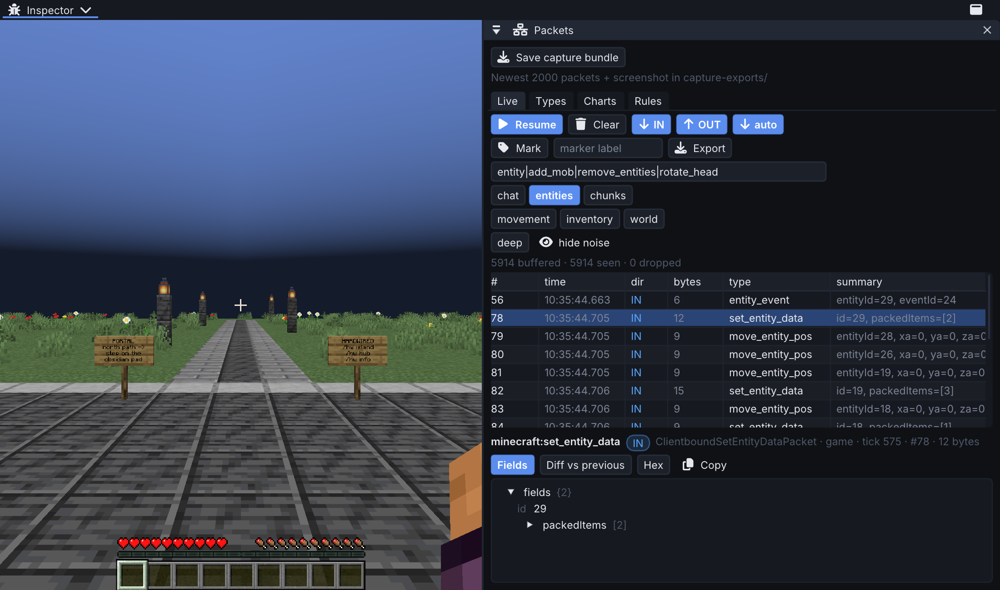
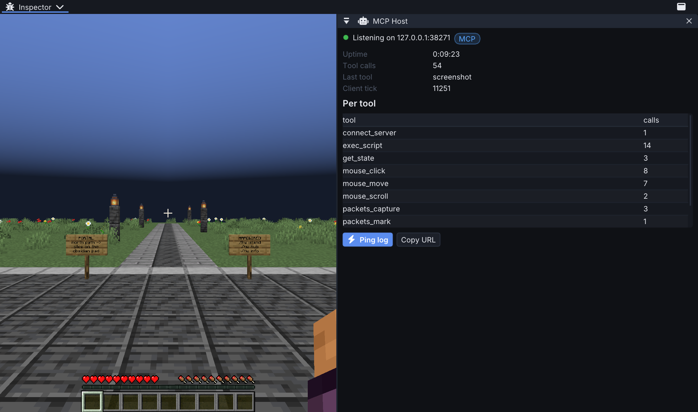

## MC-Inspector 0.1.0

First downloadable release: a Fabric client mod for inspecting Minecraft packets and
controlling a development client through MCP.

### Downloads

Choose exactly one MC-Inspector JAR matching your Minecraft version. Install Fabric API
and Fabric Language Kotlin **1.13.12 or newer** separately. panel-lib **0.1.4** and the
Rhino JavaScript engine are bundled.

| Minecraft | Java | Download |
| --- | --- | --- |
| 1.21.8 | 21+ | [MC-Inspector-mc1.21.8-0.1.0.jar](https://github.com/Nano112/MC-Inspector/releases/download/v0.1.0/MC-Inspector-mc1.21.8-0.1.0.jar) |
| 1.21.9 | 21+ | [MC-Inspector-mc1.21.9-0.1.0.jar](https://github.com/Nano112/MC-Inspector/releases/download/v0.1.0/MC-Inspector-mc1.21.9-0.1.0.jar) |
| 1.21.10 | 21+ | [MC-Inspector-mc1.21.10-0.1.0.jar](https://github.com/Nano112/MC-Inspector/releases/download/v0.1.0/MC-Inspector-mc1.21.10-0.1.0.jar) |
| 1.21.11 | 21+ | [MC-Inspector-mc1.21.11-0.1.0.jar](https://github.com/Nano112/MC-Inspector/releases/download/v0.1.0/MC-Inspector-mc1.21.11-0.1.0.jar) |
| 26.1 | 25+ | [MC-Inspector-mc26.1-0.1.0.jar](https://github.com/Nano112/MC-Inspector/releases/download/v0.1.0/MC-Inspector-mc26.1-0.1.0.jar) |
| 26.2 | 25+ | [MC-Inspector-mc26.2-0.1.0.jar](https://github.com/Nano112/MC-Inspector/releases/download/v0.1.0/MC-Inspector-mc26.2-0.1.0.jar) |

`SHA256SUMS.txt` contains a checksum for every JAR.

### Included

- 38 MCP tools: screenshots, client state, menus, input, commands, scripting and packet inspection.
- Packet fields, hex, diffs, filters, markers, charts, breakpoints and rewrite rules.
- JSONL, CSV and PCAP packet exports.
- **New capture bundles:** a ZIP with packets, markers, client context and an optional screenshot.
  Use `capture_bundle` or **Save capture bundle** in the Packets panel. Exports go to
  `<gameDir>/capture-exports/`; the manifest reports buffer evictions, exclusions and truncation.
- Capture keys: **F8** start/stop; **F9** marker. **O** opens Packets; **I** opens MCP Host;
  **K** toggles the shared overlay. Clear/export bindings are initially unbound.

### Build and reliability fixes

- Fixed Minecraft 26.2's action-bar API change so capture keybind feedback compiles.
- Pinned CI's panel-lib checkout and aligned the bundled dependency to 0.1.4.
- Raised the Fabric Language Kotlin minimum to the version used by these builds.
- Cancelled timed-out screenshot requests and cleaned up temporary PNGs.
- Release checks reject missing/wrong-version JARs and validate bundled dependencies.

Capture bundles snapshot the rolling buffer; they are not an offline replay browser or
continuous recorder. [Feature review](https://github.com/Nano112/MC-Inspector/blob/main/docs/feature-review.md)
tracks entity timelines, resource-pack inspection and the next investigation features.

### Validation

All six version builds passed with 318 tests. Live client checks covered 1.21.11 connected to a local
Hardwired server, plus 26.2 startup, its action-bar API, screenshots and capture-bundle export.
The other four targets were build/test validated; they were not launched for this release.

Automated overlay clicks were intermittent during window resize/focus changes in the macOS
development smoke test. Direct MCP capture/export worked; input focus remains a follow-up.

### Screenshots

